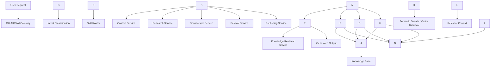
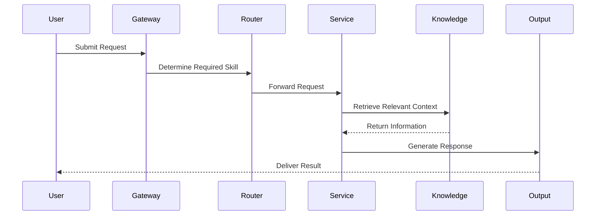
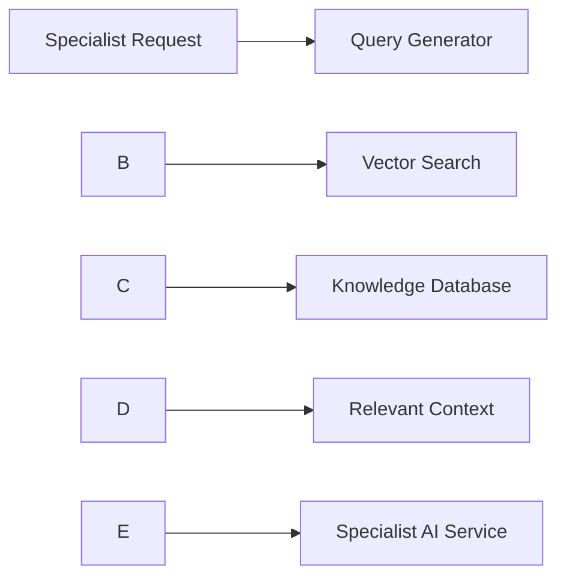
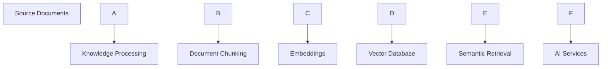
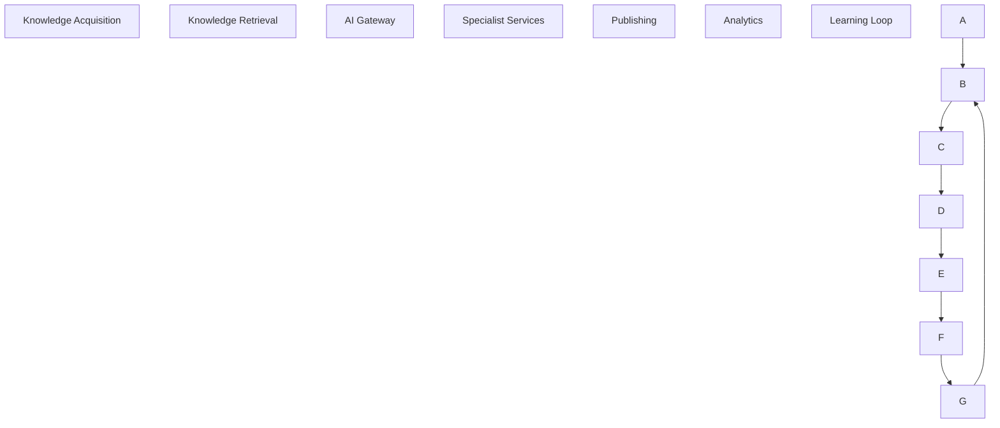

\# GH-AIOS Architecture


\## Greenhouse AI Operating System


Version: \*\*v1.0.0\*\*


Status: \*\*Stable Release\*\*


\---


\# 1. System Overview


GH-AIOS (Greenhouse AI Operating System) is a modular multi-agent AI architecture designed to support the Greenhouse Futures Lab ecosystem.


The system separates intelligence into specialized services, allowing each AI component to focus on a specific operational domain.


Instead of one general AI agent performing every task, GH-AIOS operates as a coordinated network of specialist AI services managed through a central AI Gateway.


\---


\# 2. High-Level Architecture





\---


\# 3. Request Lifecycle


Every GH-AIOS interaction follows this process:





\---


\# 4. Core Components


\## 4.1 AI Gateway


The AI Gateway is the entry point of GH-AIOS.


Responsibilities:


\- Receive user requests

\- Understand user intent

\- Identify required specialist

\- Route requests

\- Maintain consistent communication between services


The Gateway acts as the operating system layer that coordinates all AI workers.


\---


\# 4.2 Knowledge Retrieval Service


The Knowledge Retrieval Service provides intelligence grounding.


Responsibilities:


\- Generate optimized search queries

\- Retrieve relevant information

\- Search semantic knowledge stores

\- Provide context to specialist services


Architecture:





\---


\# 4.3 Specialist Services


GH-AIOS v1.0 contains five operational specialists.


\---


\## Content Service


Purpose:


Create communication and storytelling assets.


Examples:


\- Social media posts

\- Campaign messaging

\- Articles

\- Newsletters

\- Public communication


\---


\## Research Service


Purpose:


Transform information into intelligence.


Examples:


\- Research reports

\- Climate analysis

\- Summaries

\- Strategic insights


\---


\## Sponsorship Service


Purpose:


Support partnerships and funding activities.


Examples:


\- Sponsorship proposals

\- Partnership letters

\- Corporate outreach


\---


\## Festival Service


Purpose:


Support event design and execution.


Examples:


\- Festival programmes

\- Logistics planning

\- Experience design

\- Operations planning


\---


\## Publishing Service


Purpose:


Prepare and distribute approved content.


Examples:


\- LinkedIn publishing

\- Instagram publishing

\- Newsletter distribution

\- Platform adaptation


\---


\# 5. Knowledge Architecture


GH-AIOS uses a knowledge-driven design.





\---


\# 6. Version 1 Architecture


GH-AIOS v1.0.0 contains:


```

AI Gateway


Knowledge Retrieval Service


Content Service


Research Service


Sponsorship Service


Festival Service


Publishing Service

```


\---


\# 7. Future Architecture


Future versions will introduce:





\---


\# 8. Design Principles


\## Modular


Each service operates independently.


\## Scalable


New AI specialists can be added without redesigning the system.


\## Knowledge Driven


AI responses are grounded in organizational knowledge.


\## Maintainable


Every component can be updated independently.


\## Human-Centered


AI supports human decision-making and creativity.


\---


\# 9. Future Expansion


Potential future services:


\- Knowledge Acquisition Service

\- Analytics Service

\- Finance Service

\- Volunteer Management Service

\- Community Engagement Service

\- Impact Measurement Service


\---


\*\*GH-AIOS\*\*


Building the intelligence layer for climate innovation.

